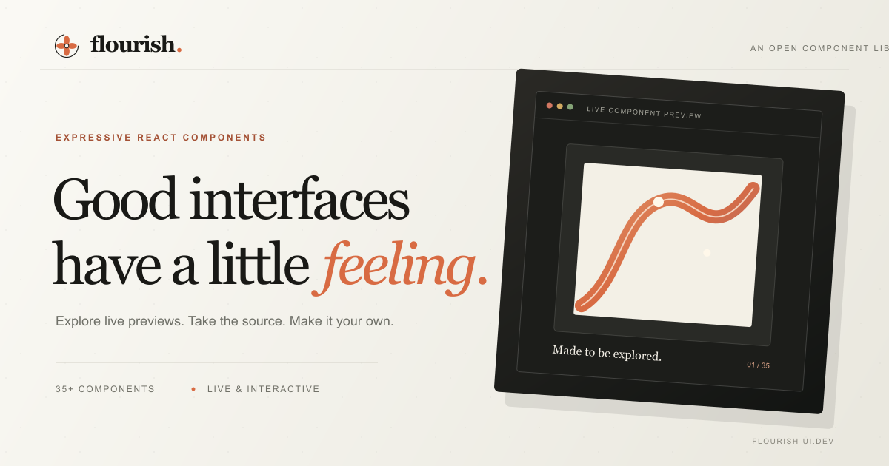
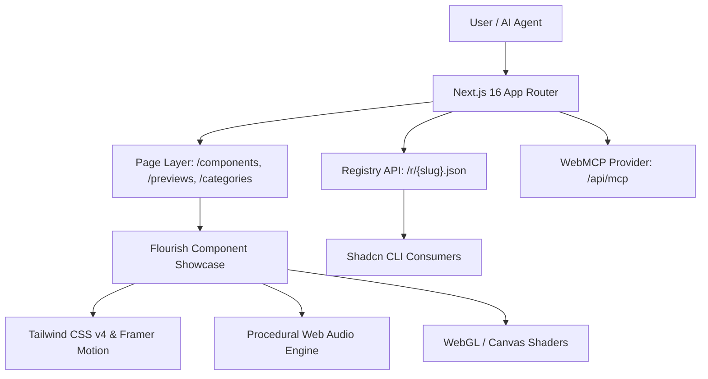

<div align="center">
  <a href="https://flourish-ui.vercel.app">
    
  </a>

  <h1>🌿 Flourish UI — Web Platform & Component Registry</h1>
  
  <p>
    <strong>The official web application, interactive documentation, and shadcn-compatible component registry for Flourish UI.</strong>
  </p>

  <p>
    <a href="https://nextjs.org/"></a>
    <a href="https://react.dev/"></a>
    <a href="https://tailwindcss.com/"></a>
    <a href="https://www.typescriptlang.org/"></a>
    <a href="https://opensource.org/licenses/MIT"></a>
  </p>

  <p>
    <a href="https://flourish-ui.vercel.app"><strong>Explore Live Website →</strong></a> • 
    <a href="./public/PublishVideo.mp4">🎬 <strong>Watch Launch Video (MP4)</strong></a> • 
    <a href="https://flourish-ui.vercel.app/components"><strong>Browse 50+ Components</strong></a> • 
    <a href="https://flourish-ui.vercel.app/developers"><strong>Developer Docs</strong></a>
  </p>
</div>

---

## 📖 Table of Contents

- [Overview](#-overview)
- [Why Flourish UI?](#-why-flourish-ui)
- [Key Features](#-key-features)
- [Component Categories (50 Components)](#-component-categories-50-components)
- [Architecture & Tech Stack](#-architecture--tech-stack)
- [Project Structure](#-project-structure)
- [Local Development](#-local-development)
- [Shadcn Registry Integration](#-shadcn-registry-integration)
- [WebMCP & AI Agent Tooling](#-webmcp--ai-agent-tooling)
- [Author Profile & Digital Craftsmanship](#-author-profile--digital-craftsmanship)
- [Contributing](#-contributing)
- [License](#-license)

---

## 🌟 Overview

`apps/web` is the flagship frontend application that powers **[Flourish UI](https://flourish-ui.vercel.app)**. It serves as both an interactive showcase museum for modern digital craftsmanship and a production-grade component distribution registry.

Every component in the library can be inspected in real time, manipulated with live interactive controls, viewed across responsive viewports, and installed into any Next.js or React project with a single CLI command.

### 🎯 Key Metrics
- **50+ Production-Ready Components** across 6 distinct design archetypes.
- **100% Free & Open Source** under the permissive MIT license.
- **Zero Proprietary Lock-In**: Direct source copy-pasting or automated installation via the standard `shadcn` CLI.
- **Native Tailwind CSS v4 & React 19** architectural foundation.

---

## 💡 Why Flourish UI?

Over the past decade, modern interface design flattened out. In pursuit of minimal cleanliness, the web lost its texture, its depth, and its joy. Everything began looking like the same generic admin dashboard with muted gray cards and borderless buttons.

**Flourish UI exists to bring feeling back to the web.**

It combines:
1. **Physical Skeuomorphism**: Tactile depth, inset switch wells, physical notebooks, and authentic material lighting.
2. **Procedural Shaders & WebGL**: Iridescent foil cards, simplex noise light glares, and real-time canvas dynamics.
3. **Spring Physics & Kinetic Motion**: Micro-interactions tuned with spring dampers and fluid easing curves using Framer Motion and GSAP.
4. **Editorial & Typographic Precision**: Neo-classical serif hierarchies and thoughtful whitespace.

---

## ⚡ Key Features

### 🖥️ 1. Interactive Isolated Previews
- Every component features a dedicated, isolated preview route under `/previews/[slug]`.
- Built-in viewport simulator with instant switching between **Desktop (1400px)**, **Tablet (768px)**, and **Mobile (375px)**.
- Fullscreen mode for immersive live testing.
- Direct syntax-highlighted source code inspection with instant one-click copy.

### 📦 2. Shadcn-Compatible JSON Registry
- Serves compliant component definitions at `/r/[slug].json` and an aggregated manifest at `/r/registry.json`.
- Consumers can install any component directly into their codebase without manual downloading:
  ```bash
  pnpm dlx shadcn@latest add https://flourish-ui.vercel.app/r/admit-one-3-d-holographic-ticket.json
  ```

### 🔊 3. Tactile Audio Design
- Built-in synthesized Web Audio feedback engine (`ui-sounds.ts`) with custom procedural sound synthesis for switches, buttons, modals, and tabs.
- Global volume/mute toggle (`sound-toggle.tsx`) that respects user preference and system accessibility settings (`prefers-reduced-motion`).

### 🤖 4. Native WebMCP & AI Agent Integration
- Implements the **Model Context Protocol (WebMCP)** via `WebMcpProvider`.
- Exposes structured tools directly to browser-based AI assistants (Claude, Gemini, Antigravity, Cursor) allowing agents to search components, inspect props, and extract code natively.
- Provides `/llms.txt` and `/llms-full.txt` endpoints tailored for Large Language Model context injection.

### 🔍 5. Best-in-Class Technical SEO
- Dynamic and automated OpenGraph & Twitter image generation (`og-image.png`, `og-image.svg`).
- Full Schema.org JSON-LD graph generation for SoftwareApplications, WebPages, Organizations, and Authors.
- Dynamic `sitemap.xml` and granular `robots.txt` optimized for search indexers and AI scrapers.

---

## 🗂️ Component Categories (50 Components)

| Category | Description | Flagship Components |
|---|---|---|
| **Shaders & WebGL** | Procedural WebGL effects, simplex noise, and shader reflections | *Admit One 3D Holographic Ticket, Prismatic Liquid Shader, Waves Shaders Homlu UI, Cold Flame Drift, Ink Orbit Hero* |
| **Skeuomorphic & 3D** | Realistic materials, tactile depth, analog dials, and physical hardware | *Liquid Glass Folder Stack, Shelter Skin Team Dossier, Skeuomorphic Verify Email, Digital Journal Album, Voyage Planner* |
| **Motion & Physics** | Spring-based choreography, gesture dragging, and responsive hover dynamics | *Velocity Spring System, Kinetic Hover, Draggable Widget Grid, Post Planner Calendar* |
| **Canvas & Generative** | HTML5 canvas simulations, procedural particles, and generative geometry | *Botanical Pixel Dispersion, Hero ASCII One, Particle Wordmark, Storybook Play Canvas, Raster Dynamics Wordmark* |
| **Dashboards & Editors** | High-utility workflows, creative tools, and refined analytics | *Agent Orchestration Dashboard, Isometric Dashboard, Proma Content Workspace, Property Comparison* |
| **Interactive Surfaces** | Expressive sections, delightful error states, and onboarding flows | *Morning, Mostly — Five Small Rituals, The Swedish Candy Cart of Your Dreams, Letters from the Garden, Sequel Frontier Footer, Genesis Onboarding Card, House Savings Goal Card, 404 Error Page Component, Bloom Select* |

---

## 🛠️ Architecture & Tech Stack



### Core Technologies
- **Framework**: [Next.js 16](https://nextjs.org/) (App Router, React Server Components, Turbopack)
- **UI Library**: [React 19](https://react.dev/)
- **Styling**: [Tailwind CSS v4](https://tailwindcss.com/) with `@tailwindcss/postcss` and `tw-animate-css`
- **Animation**: [Framer Motion](https://www.framer.com/motion/), `motion`, and [GSAP](https://gsap.com/)
- **Primitives**: [@base-ui/react](https://base-ui.com/) and [Lucide React](https://lucide.dev/)
- **Shaders**: [@paper-design/shaders-react](https://github.com/paper-design/shaders-react)
- **Analytics**: [@vercel/analytics](https://vercel.com/analytics)
- **Package Manager**: [pnpm](https://pnpm.io/)

---

## 📁 Project Structure

```text
apps/web/
├── app/
│   ├── layout.tsx               # Root layout, metadata, WebMCP provider, analytics
│   ├── page.tsx                 # Homepage with hero, spotlights, and interactive catalog
│   ├── globals.css              # Tailwind v4 theme, fonts, animations, utilities
│   ├── components/              # Component catalog directory & detail pages (/components/[slug])
│   ├── previews/                # 50+ isolated preview routes (/previews/[slug])
│   ├── categories/              # Filtered category pages (/categories/[category])
│   ├── developers/              # Developer guides, CLI instructions, registry docs
│   ├── changelog/               # Component version history and updates
│   ├── about/                   # Flourish UI story, design philosophy, author profile
│   ├── contact/                 # Contact details, commission requests, social links
│   ├── privacy/                 # Privacy statement & analytics policy
│   ├── r/                       # Public shadcn registry API endpoints
│   ├── api/                     # REST and WebMCP server endpoints
│   ├── sitemap.ts               # Dynamic XML sitemap generation
│   ├── robots.ts                # SEO and crawler robots configuration
│   ├── sound-toggle.tsx         # Global UI audio switch
│   └── ui-sounds.ts             # Web Audio API sound generator
├── config/
│   ├── components.ts            # Component metadata database (50 entries)
│   └── component-sources/       # Raw TypeScript/TSX source strings for registry distribution
├── public/
│   ├── previews/                # High-res webp/png preview thumbnails for all 50 components
│   ├── flourish-ui-showcase.gif # Animated showcase demo
│   ├── flourish-ui-showcase.mp4 # HD presentation video
│   ├── flourish-ui-linkedin-banner.jpg # 3D isometric presentation banner
│   ├── zuhaib-rashid.webp       # Author profile photograph
│   └── llms.txt & llms-full.txt # LLM context feeds
├── scripts/
│   └── link-root-dependencies.mjs # Workspace dependency linking
├── components.json              # Shadcn configuration
└── package.json                 # Web dependencies and scripts
```

---

## 🚀 Local Development

### Prerequisites
- **Node.js**: `v20.0.0` or later
- **pnpm**: `v9.0.0` or later

### 1. Clone the Monorepo
```bash
git clone https://github.com/Zuhaib-dev/Flourish-UI.git
cd Flourish-UI
```

### 2. Install Dependencies
```bash
pnpm install
```

### 3. Start the Development Server
```bash
# Run web application only
pnpm --filter web dev

# Or run from inside apps/web
cd apps/web
pnpm dev
```
Open [http://localhost:3000](http://localhost:3000) in your browser to inspect the application.

### 4. Quality Checks & Verification
```bash
# Type check TypeScript across all routes
pnpm --filter web typecheck

# Production build test
pnpm --filter web build
```

---

## 📥 Shadcn Registry Integration

Flourish UI operates as a remote registry compatible with the standard `shadcn` CLI.

### Option A: Install via URL
```bash
pnpm dlx shadcn@latest add https://flourish-ui.vercel.app/r/admit-one-3-d-holographic-ticket.json
```

### Option B: Add Registry Namespace
Add the `@flourish` namespace to your project's `components.json`:
```json
{
  "registries": {
    "@flourish": "https://flourish-ui.vercel.app/r/{name}.json"
  }
}
```

Now you can install components using concise aliases:
```bash
pnpm dlx shadcn@latest add @flourish/liquid-glass-folder-stack
pnpm dlx shadcn@latest add @flourish/genesis-onboarding-card
pnpm dlx shadcn@latest add @flourish/offline-404
```

Components are placed automatically into `components/flourish/` with all required dependencies installed into your `package.json`.

---

## 🤖 WebMCP & AI Agent Tooling

Flourish UI includes native support for **WebMCP (Web Model Context Protocol)**, enabling AI pair-programmers (such as Antigravity, Claude Code, and Cursor) to interactively inspect and retrieve components directly from the web app:

- **Endpoint**: `/api/mcp`
- **Exposed Tools**:
  - `list_components`: Lists all 50 components with slugs, categories, tags, and descriptions.
  - `get_component`: Returns full TypeScript source code, installation steps, and prop specifications.
  - `search_components`: Performs semantic search over titles, tags, and categories.

For lightweight agent context loading, check:
- [https://flourish-ui.vercel.app/llms.txt](https://flourish-ui.vercel.app/llms.txt) — Overview and component table.
- [https://flourish-ui.vercel.app/llms-full.txt](https://flourish-ui.vercel.app/llms-full.txt) — Comprehensive catalog reference.

---

## 👨‍💻 Author Profile & Digital Craftsmanship

<div align="center">
  
  
  <h3>Zuhaib Rashid</h3>
  <p><strong>Creator & Lead Engineer of Flourish UI</strong></p>
  <p><em>Full-Stack Developer • UI/UX Engineer • Creative Technologist</em></p>

  <p>
    <a href="https://www.zuhaibrashid.com"></a>
    <a href="https://github.com/Zuhaib-dev"></a>
    <a href="https://www.linkedin.com/in/zuhaib-rashid-661345318/"></a>
    <a href="https://x.com/xuhaib_x9"></a>
    <a href="mailto:zuhaibrashid01@gmail.com"></a>
  </p>
</div>

### 🌟 About the Creator
Zuhaib Rashid is a full-stack engineer and digital artisan passionate about bridging the gap between artistic emotion and software engineering. Combining modern React performance architectures with physical skeuomorphism and procedural WebGL shaders, Zuhaib designed and coded Flourish UI from scratch as a gift to the open-source community.

> *"Great software shouldn't just be functional; it should feel alive in the user's hands. When you click a switch, flip a page, or drag a card, there should be weight, resistance, and delight."*  
> — **Zuhaib Rashid**

---

## 🤝 Contributing

Contributions, feedback, and component suggestions are warmly welcomed!

1. Fork the repository on GitHub.
2. Create a feature branch (`git checkout -b feature/amazing-component`).
3. Commit your changes following standard semantic messages.
4. Push to your branch and open a Pull Request.

---

## 📄 License

This project is open-source software licensed under the **[MIT License](https://opensource.org/licenses/MIT)**.  
You are free to use, modify, distribute, and integrate Flourish UI components into both personal and commercial projects without royalties.

---

<div align="center">
  <p>Crafted with thoughtful intention by <a href="https://www.zuhaibrashid.com">Zuhaib Rashid</a></p>
  <p>⭐️ If you love Flourish UI, please consider giving the repository a star on <a href="https://github.com/Zuhaib-dev/Flourish-UI">GitHub</a>!</p>
</div>
