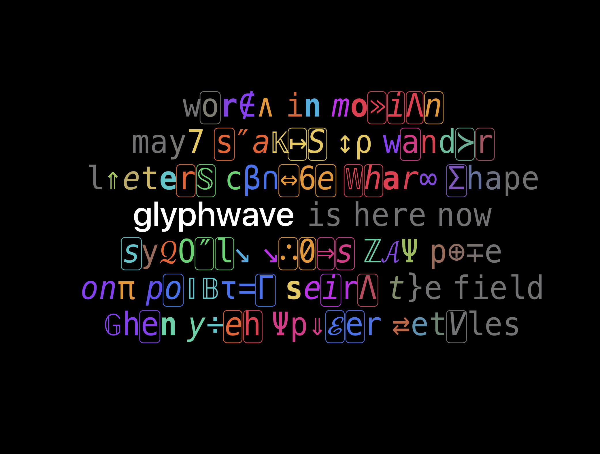

# Glyphwave Scramble

**Live page:** [Glyphwave Scramble](https://flourish-ui.vercel.app/components/glyphwave-scramble) · [Interactive preview](https://flourish-ui.vercel.app/previews/glyphwave-scramble)

**SEO title:** Glyphwave Scramble React Component | Flourish UI  
**Description:** An interactive canvas text effect that turns words into colorful mathematical symbols as the pointer passes, then settles each letter back into place.

A canvas typography effect for hero sections and editorial headers. Move a pointer across the text to send a wave of colorful mathematical symbols through each line; characters then resolve back into words. Touch input is supported, and reduced-motion preferences pause the effect.

## Preview



The preview image is included at `public/Preview.png`.

## Quick start

```bash
pnpm install
pnpm dev
```

Open `http://localhost:3000` to view the local demo.

## Use the component

```tsx
import { GlyphwaveScramble } from "./components/ui/glyphwave-scramble"

export function Hero() {
  return (
    <section className="relative h-[32rem] w-full overflow-hidden bg-black">
      <GlyphwaveScramble
        lines={["Words in motion", "Glyphwave takes shape", "Symbols settle back"]}
        highlight={["Glyphwave"]}
        className="h-full w-full"
      />
    </section>
  )
}
```

The root fills its parent and has a 360px minimum height. The component uses a 2D canvas, includes visually hidden text for assistive technology, supports pointer and touch interaction, and pauses animation when reduced motion is requested.

## Props

| Prop | Type | Default | Description |
| --- | --- | --- | --- |
| `lines` | `string[]` | Seven sample lines | Text rows, from top to bottom. |
| `highlight` | `string[]` | `["glyphwave"]` | Words or phrases kept in the highlight style and excluded from scrambling. Matching is case-insensitive. |
| `colors` | `string[]` | Multicolor palette | Colors used by scrambled symbols. |
| `color` | `string` | `#727275` | Resting text color. |
| `highlightColor` | `string` | `#ffffff` | Highlight text color. |
| `background` | `string` | `#000000` | Canvas background color; use `transparent` to show the parent. |
| `font`, `highlightFont` | `string` | System stacks | Font stacks for the regular and highlighted text. |
| `fontSize` | `number` | `0` | Font size in pixels; `0` fits to the container. |
| `autoplay` | `boolean` | `true` | Animate an invisible pointer through the text. A real pointer pauses autoplay briefly. |
| `cursor` | `boolean` | `false` | Show the small pointer during autoplay. |
| `radius` | `number` | `0.8` | Trigger distance around each word, in character widths. |
| `speed` | `number` | `1` | Playback speed multiplier. |
| `boxed` | `number` | `0.33` | Share of scrambled characters shown in thin rounded boxes. |
| `time` | `number` | — | Freeze the autoplay timeline at this many seconds for deterministic renders. |
| `className`, `style` | `string`, `React.CSSProperties` | — | Root element classes and inline styles. |

## Attribution

Adapted from Louis Studios’ **Math Scramble**, listed under the MIT License. The original source and author are credited in the component file. See the [original 21st.dev component](https://dev.21st.dev/@louisstudios/components/math-scramble).

The standalone source, preview image, and interactive website preview are linked above.
