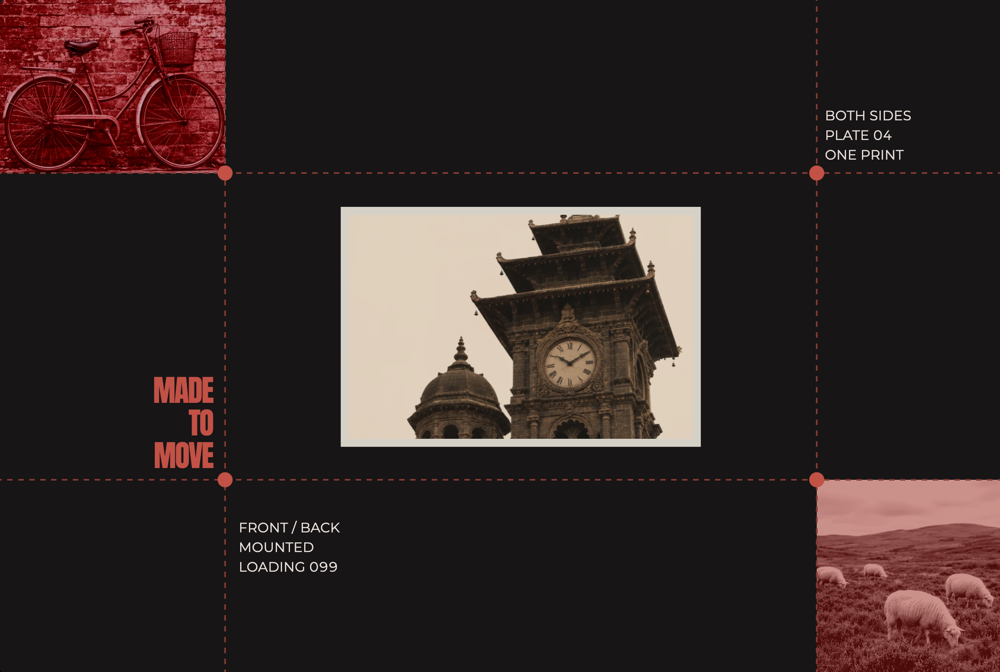

# Guideline Fan Preloader

**SEO title:** Guideline Fan Preloader React Component | Flourish UI  
**Description:** An editorial React preloader that unfolds seven photographs through a fan, a rotating cube, a picture ring, and a double-sided print.  
**Keywords:** guideline fan preloader, React preloader, editorial loading animation, image loading screen, React component.

An editorial loading sequence for portfolios, campaign pages, and other image-led experiences. Seven square photographs move through four art-directed scenes with thin layout guides, small captions, and a closing pan.

This standalone project is not yet listed in the Flourish UI website catalog. Its metadata is prepared for the planned `/components/guideline-fan-preloader` page; the catalog route still needs to be added before that canonical URL is live.

## Preview



The preview image is included at `public/Preview.png`.

## Quick start

```bash
pnpm install
pnpm dev
```

Open `http://localhost:3000` to view the demo.

## Use the component

```tsx
import { GuidelineFanPreloader } from "./components/ui/guideline-fan-preloader"

export function PageGate({ children }: { children: React.ReactNode }) {
  return (
    <GuidelineFanPreloader
      loop={false}
      scenes={4}
      text="Slow North Studio"
      onComplete={() => console.log("Intro finished")}
    >
      <main>{children}</main>
    </GuidelineFanPreloader>
  )
}
```

With `loop={false}`, the children remain inert beneath the preloader and are revealed after the closing pan. The default demo loops the reel. Set `fontHref={null}` when the host already loads Anton and Montserrat, and pass your own images to avoid the remote Unsplash defaults.

## Props

| Prop | Type | Default | Description |
| --- | --- | --- | --- |
| `text` | `string` | `"Slow North Studio"` | Wordmark in the opening scene. Whitespace separates lines; use newlines to choose line breaks. |
| `title` | `string` | `"Full Circle"` | Title shown beside the photo ring. |
| `headline` | `string` | `"Made to move"` | Up to three short words shown in the final scene. |
| `scenes` | `number` | `4` | Number of scenes to play, from 1 to 4. |
| `loop` | `boolean` | `true` | Repeat the reel. Set false to pan away and reveal children. |
| `duration` | `number` | — | Length of one pass in seconds. Unset, the animation uses its reference timing. |
| `onComplete` | `() => void` | — | Called after the overlay exits when `loop` is false. |
| `children` | `React.ReactNode` | — | Page content revealed after a non-looping pass. |
| `images` | `string[]` | Seven Unsplash photos | Square image URLs; the component reuses them across the fan and 3D solids. |
| `labels` | `Partial<GuidelineFanPreloaderLabels>` | Built-in captions | Override any scene caption while retaining the other defaults. |
| `counterLabel` | `string` | `"Loading"` | Text before the animated counter. Pass an empty string to hide it. |
| `place`, `region` | `string` | `"OSL"`, `"NOR"` | Short location badge text. |
| `paper`, `ink`, `accent` | `string` | Built-in palette | Override the paper, ink, and accent colors with CSS color values. |
| `height` | `string` | `"100svh"` | Definite height for the component root. |
| `fontHref` | `string \| null` | Google Fonts stylesheet | Stylesheet URL for Anton and Montserrat, or null if already loaded by the host. |
| `className` | `string` | — | Additional class names for the root. |

## SEO and preview metadata

The app layout defines the page title, description, keywords, canonical, Open Graph and X card details, and `SoftwareSourceCode` JSON-LD. The social card uses the component preview image. The canonical and Open Graph URL point to the planned component detail route and will resolve after the website catalog integration.

## Notes

- The component has no animation or icon package dependency. Its motion is driven by one `requestAnimationFrame` loop and stops when the component unmounts.
- It checks `prefers-reduced-motion`. In that mode it holds a still frame, then completes the page reveal when looping is disabled.
- The demo's seven image URLs and the default Google Fonts stylesheet load from external services. Pass self-hosted image URLs and `fontHref={null}` for a fully self-hosted installation.
- The sample photos come from [Unsplash](https://unsplash.com/license). Replace them with images that fit your project and credit photographers as required by your use case.
